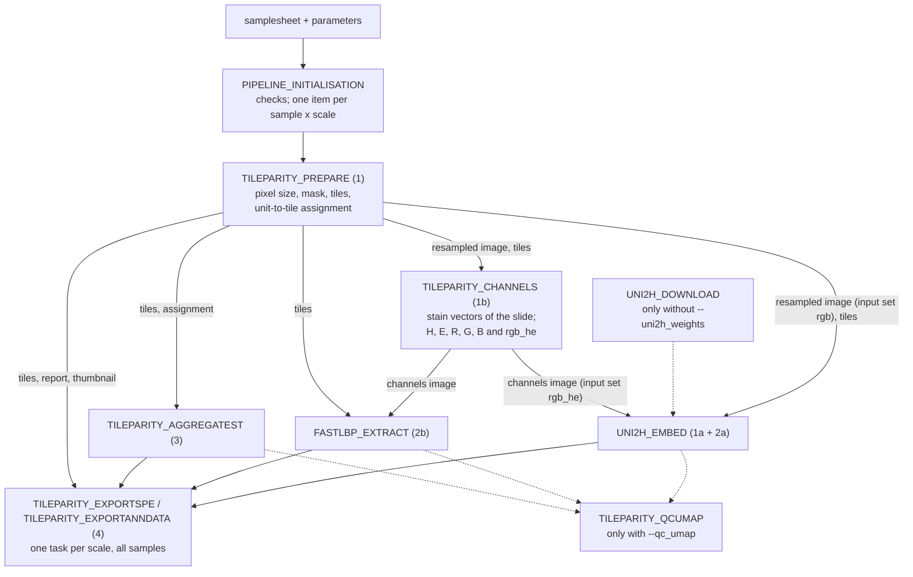

# Structure: processes, files and lineage

This page is the map of the pipeline: which process runs, what it reads, what it writes, and how every output records where it comes from. The reasons behind each method are in [design.md](design.md); the output files are described column by column in [output.md](output.md).

## The processes



Every task of Processes 1 to 3 works on one sample at one scale (`<id>` = `<sample>_mpp<scale>`, e.g. `A_P1_CRC_mpp0.5000`); the exports and the QC page gather all samples of one scale. Only Process 1 makes geometric decisions; every later step reads its tile table. Process 1b computes every input image of the extractors once, so UNI2-h and fastLBP read exactly the same pixels in each input set (`rgb`: the slide; `rgb_he`: the slide rebuilt from haematoxylin and eosin only).

| process | step (lineage) | reads | writes | published to |
|---|---|---|---|---|
| `PIPELINE_INITIALISATION` | — | samplesheet, parameters | nothing (stops with a message if something is wrong) | — |
| `TILEPARITY_PREPARE` | `prepare` | original image; Space Ranger folder or HEST `.h5ad` (optional); external mask (optional) | `resampled.tif`, `tiles.tsv.gz`, `assignment.tsv.gz`, `thumbnail.png`, `mask.png`, `overlay.png`, `tissue_thresholds.png`, `mask_compare.{png,tsv}` (with `--mask_compare`), `prepare.json` | `<sample>/mpp<scale>/prepare/` |
| `TILEPARITY_CHANNELS` | `channels` | `resampled.tif`, `tiles.tsv.gz` | `channels.tif` (H, E always; R, G, B for fastLBP's `rgb`; R_he, G_he, B_he = `rgb_he`), `channels.json` (bands, stain vectors, summary), `rgb_he_qc.{png,tsv}` (with `rgb_he`) | `<sample>/mpp<scale>/channels/` |
| `FASTLBP_EXTRACT` | `lbp` | `channels.tif`, `channels.json`, `tiles.tsv.gz` | `lbp.h5`, `lbp_qc.{png,tsv}` | `<sample>/mpp<scale>/lbp/` |
| `UNI2H_DOWNLOAD` | — | `HF_TOKEN` | UNI2-h weights (work directory only) | — |
| `UNI2H_EMBED` | `uni2h` | `resampled.tif` (`rgb`), `channels.tif` (`rgb_he`), `tiles.tsv.gz`, weights | `uni2h.h5` (one block per input set) | `<sample>/mpp<scale>/uni2h/` |
| `TILEPARITY_AGGREGATEST` | `st` | `tiles.tsv.gz`, `assignment.tsv.gz`, Space Ranger folder or HEST `.h5ad` | `counts.h5`, `counts_summary.tsv`, `aggregate.json` | `<sample>/mpp<scale>/st/` |
| `TILEPARITY_EXPORTSPE` | `spe`, `spe_combined` | everything above, for all samples of a scale | `<id>.rds`, `combined_mpp<scale>.rds` | `export/mpp<scale>/spe/` |
| `TILEPARITY_EXPORTANNDATA` | `anndata`, `anndata_combined` | as the SPE export | `<id>.h5ad`, `combined_mpp<scale>.h5ad` | `export/mpp<scale>/anndata/` |
| `TILEPARITY_QCUMAP` | `qc_umap` | as the exports | `combined_mpp<scale>.qc_umap.{html,tsv.gz}` | `qc/mpp<scale>/` |

Every process also writes `<id>.<step>.lineage.json` next to its outputs (published with them) and a `versions.yml` (collected in `pipeline_info/software_versions.yml`). The large images (`resampled.tif`, `channels.tif`) stay in the work directory unless `--publish_images` is set.

## Which tiles each step uses

Process 1 writes one row per candidate tile (any tissue) with two decisions:

* `extract`: features and counts are computed for this tile. True when the tile lies inside the image, has at least `--min_tissue_extract` tissue (default: the same as `--min_tissue`), passes the spatial checks (`--min_st_coverage` for Visium HD, `--min_spot_overlap` for Visium on the grid) and, with `--drop_blurred`, is not blurred.
* `keep`: the default set for analysis. True when the tile is extracted *and* has at least `--min_tissue` tissue.

`qc_fail` lists every reason a tile fails `keep` (`outside_image`, `low_tissue`, `low_st_coverage`, `no_st_units`, `blurred`). Process 1b computes the channels image for the whole slide, but estimates the slide's stain colours from pixels of the `extract` tiles and reports `rgb_he` per `extract` tile. UNI2-h, LBP and the expression aggregation read the `extract` tiles; the exports contain the `extract` tiles with both columns, so an analysis can use `keep` or any stricter threshold on `tissue_fraction` without rerunning anything.

## Lineage: where every output comes from

A lineage file describes one step and contains the records of every step upstream of it:

```json
{
  "schema": "tileparity-lineage/1",
  "record": {
    "uid": "lbp:A_P1_mpp0.5000:3f9c2a1b7d0e",
    "step": "lbp",
    "process": "TILEPARITY_PIPELINE:TILEPARITY:FASTLBP_EXTRACT",
    "created_utc": "2026-10-24T10:00:00Z",
    "tileparity_version": "0.3.0",
    "command": ["tp_extract_lbp.py", "--channels-image", "A_P1_mpp0.5000.channels.tif", "..."],
    "parameters": {"channel_sets": "rgb,rgb_he", "...": "..."},
    "software": {"python": "3.13.16", "fastlbp": "0.3.4", "...": "..."},
    "inputs":  {"channels": {"name": "A_P1_mpp0.5000.channels.tif", "bytes": 123, "sha256": "..."}},
    "outputs": {"features": {"name": "A_P1_mpp0.5000.lbp.h5", "bytes": 456, "sha256": "..."}},
    "parents": ["channels:A_P1_mpp0.5000:..."]
  },
  "ancestors": {"channels:A_P1_mpp0.5000:...": {"...": "..."}, "prepare:A_P1_mpp0.5000:...": {"...": "..."}}
}
```

* `record` is the step itself: the exact command, every parameter, the software versions, and each input and output file with its size and SHA-256 checksum (files above 2 GiB: a checksum of their first and last 64 MiB and their size, marked `sha256_head_tail_size`). The R export uses MD5 checksums.
* `parents` are the records whose outputs this step read; `ancestors` holds each upstream record once. Following `parents` from the export back gives the whole route; the first record (`prepare`) names the original image with its checksum.
* An output can be checked against its lineage with `sha256sum <file>`. The checksum chain connects the steps: the `outputs` of `prepare` appear, with the same checksums, as the `inputs` of `uni2h` and `channels`, and the `outputs` of `channels` as the `inputs` of `lbp` and (for `rgb_he`) `uni2h`. The stain vectors of each slide are in the `parameters` of `channels` (and in `channels.json`).
* Folders (a Space Ranger `outs/`) are recorded by name only, not checksummed.

The exported objects carry their lineage too, as JSON text: `metadata(spe)$tileparity$lineage` (SpatialExperiment) and `adata.uns["tileparity"]["lineage"]` (AnnData), for every per-sample and every combined object. The `<id>.spe.lineage.json` and `<id>.anndata.lineage.json` files add the checksum of the object file itself.

```r
lin <- jsonlite::fromJSON(metadata(spe)$tileparity$lineage, simplifyVector = FALSE)
vapply(lin$ancestors, function(r) r$process, "")       # every step upstream
```

```python
import json, anndata as ad
lin = json.loads(ad.read_h5ad("combined_mpp0.5000.h5ad").uns["tileparity"]["lineage"])
sorted({r["process"] for r in lin["ancestors"].values()})
```

This is tileparity's own format (no plugin needed). Nextflow's execution report, trace and DAG in `pipeline_info/` describe the run as a whole.

## Figures

Every figure is a PNG with a title strip, the figure and a caption underneath in four parts: **What it shows**, **How to read it**, **Caveats** and **Where it comes from** (the chain of processes, the original input files and the sample and scale), so a figure keeps its meaning when it is copied out of the results folder.

| figure | made by | shows |
|---|---|---|
| `prepare/<id>.overlay.png` | Process 1 | the tiles (kept, dropped) and Space Ranger's spatial units over the thumbnail |
| `prepare/<id>.tissue_thresholds.png` | Process 1 | which tiles each tissue threshold (`--qc_tissue_thresholds`, default 30/50/80 %) would keep |
| `prepare/<id>.mask_compare.png` | Process 1, with `--mask_compare` | the mask used next to the other methods and finer resolutions, with Dice overlap and agreement with Space Ranger |
| `channels/<id>.rgb_he_qc.png` | Process 1b, with input set `rgb_he` | the slide next to its version rebuilt from H and E only, how much each pixel changed, and the tiles with the median, 90th-percentile and largest change |
| `lbp/<id>.lbp_qc.png` | Process 2b | the share of irregular LBP patterns per channel and radius |
| `qc/mpp<scale>/combined_mpp<scale>.qc_umap.html` | QC, with `--qc_umap` | interactive 3-D UMAP of every feature view (UNI2-h and LBP per input set, expression) |
